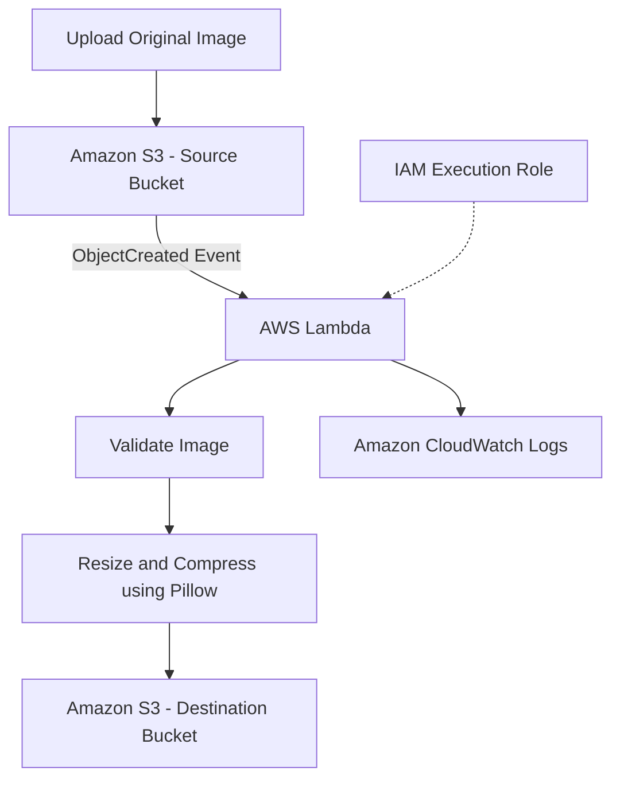

# Automated Image Processing System using AWS

A serverless image-processing application built using Amazon S3, AWS Lambda, Python, and Pillow. The system automatically resizes and compresses uploaded images through an event-driven architecture.

## Architecture



## Features

- Automatic image processing triggered by S3 uploads.
- Image resizing with a maximum dimension of 1024 × 1024 pixels.
- JPEG compression and optimization.
- Supports JPEG, PNG, and WEBP input formats.
- Maximum upload size validation: 10 MB.
- Image pixel-count validation: 25 million pixels.
- EXIF orientation correction.
- Transparent images converted to a white background.
- Structured logging using Amazon CloudWatch.
- IAM-based permissions for S3 access.

## Technology Stack

| Technology | Purpose |
|---|---|
| Amazon S3 | Stores original and processed images |
| AWS Lambda | Executes image-processing logic |
| Python 3.14 | Application development |
| Pillow | Image manipulation and compression |
| AWS IAM | Access control and permissions |
| Amazon CloudWatch | Logging and monitoring |
| Lambda Layers | External Python dependencies |

## Project Structure

```text
aws-automated-image-processing/
├── lambda/
│   └── lambda_function.py
├── architecture/
├── screenshots/
├── .gitignore
├── README.md
└── requirements.txt
```

## How It Works

1. An image is uploaded to the source S3 bucket.
2. Amazon S3 generates an object-created event.
3. The event automatically invokes the Lambda function.
4. Lambda retrieves the uploaded image.
5. Pillow validates, resizes, and compresses the image.
6. The processed image is saved in the destination S3 bucket.
7. CloudWatch records processing information and execution logs.

## Configuration

The Lambda function uses the following environment variable:

`DEST_BUCKET` – Name of the destination S3 bucket.

Lambda configuration:
- Runtime: Python 3.14
- Memory: 512 MB
- Timeout: 30 seconds
- Architecture: x86_64

## Performance Test

A successful test was performed using a JPEG image.

| Metric | Original | Processed |
|---|---:|---:|
| File size | 2,257,129 bytes | 79,419 bytes |
| Dimensions | 6000 × 3375 | 1024 × 576 |
| Format | JPEG | JPEG |

**Result:** Approximately 96.48% reduction in file size.

Processing duration: 1.77 seconds.

*Results are from one successful test execution and may vary with image content and size.*

## Deployment Overview

1. Create two private S3 buckets.
2. Create an IAM execution role with appropriate S3 permissions and CloudWatch logging access.
3. Package Pillow as an AWS Lambda Layer compatible with the selected runtime and architecture.
4. Create the Lambda function and attach the layer.
5. Configure the destination bucket environment variable.
6. Configure an S3 ObjectCreated event notification on the source bucket.
7. Upload an image and verify the output in the destination bucket.
8. Monitor execution logs in CloudWatch.

## Security

- S3 Block Public Access is enabled.
- Lambda accesses S3 through an IAM execution role.
- Separate buckets are used for original and processed images.
- AWS credentials and local dependency packages are excluded from Git.

## Future Improvements

- Add support for additional image formats.
- Introduce automated testing.
- Add dead-letter handling and failure notifications.
- Add image-processing metrics and dashboards.

## Author

Prathvik Shriyan

GitHub: https://github.com/Prathvik04
